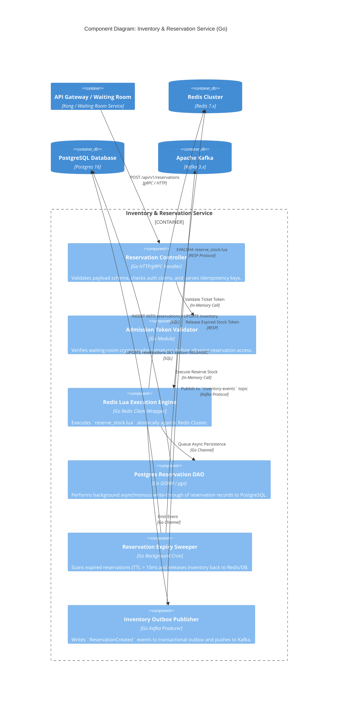
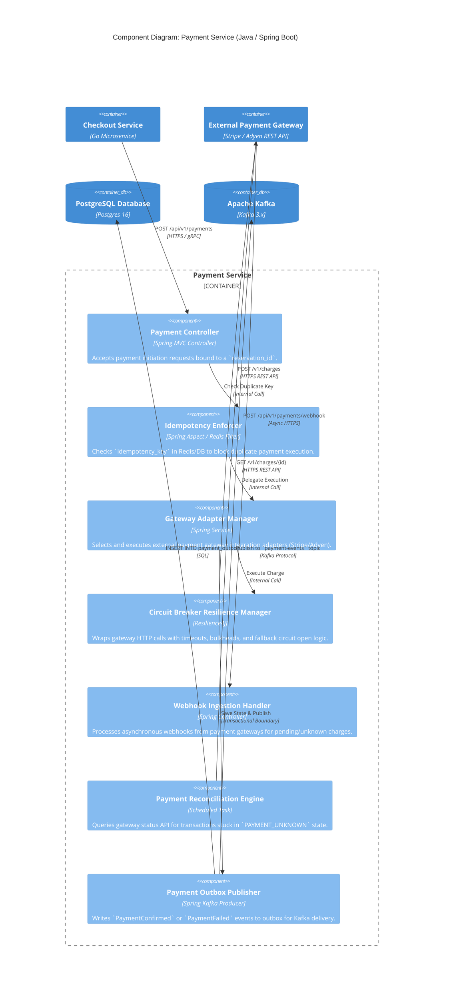
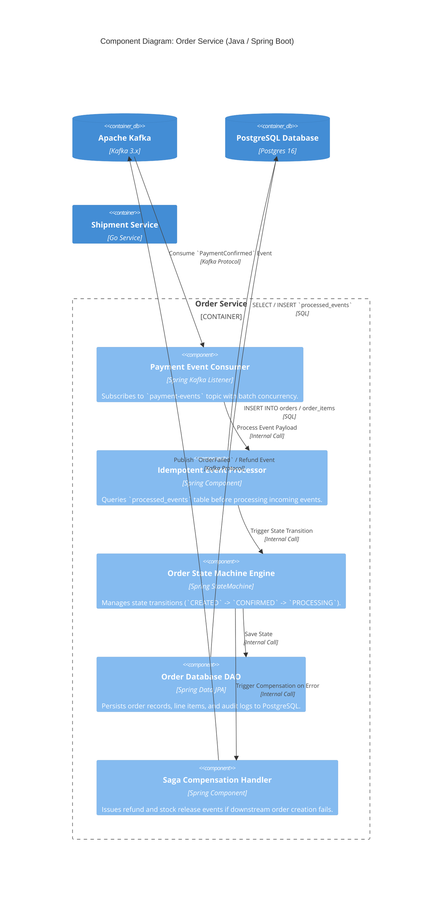

# C4 Level 3: Component Diagrams

This document details the internal software architecture for the three critical core microservices: **Inventory & Reservation Service**, **Payment Service**, and **Order Service**.

---

## 1. Inventory & Reservation Service (Component Diagram)

### Component Breakdown: Inventory & Reservation Service
1. **Reservation Controller:** Exposes gRPC and REST endpoints. Responsible for input validation, sanitization, and request routing.
2. **Admission Token Validator:** Decrypts and validates token bucket signatures issued by the Virtual Waiting Room to prevent unauthorized direct API bypasses.
3. **Redis Lua Execution Engine:** Wraps the Redis client library. Invokes the atomic reservation script (`reserve_stock.lua`) which verifies customer purchase limits, stock balance, and idempotency in a single single-threaded Redis execution thread.
4. **Postgres Reservation DAO:** Handles durable persistence in PostgreSQL asynchronously via worker channels, maintaining the transactional outbox table.
5. **Reservation Expiry Sweeper:** Scheduled daemon that queries PostgreSQL for reservations where `status = 'RESERVED'` and `expires_at < NOW()`, triggering idempotent stock replenishment.

---

## 2. Payment Service (Component Diagram)

### Component Breakdown: Payment Service
1. **Payment Controller:** Validates payment request schemas and client-generated idempotency keys.
2. **Idempotency Enforcer:** Intercepts payment invocations. If an `idempotency_key` has already been processed or is currently executing, it blocks redundant calls and returns the cached payment status.
3. **Gateway Adapter Manager:** Abstract strategy pattern facilitating runtime switching between primary (Stripe) and secondary (Adyen) payment processors.
4. **Circuit Breaker Resilience Manager:** Utilizes Resilience4j to enforce a strict 2,000ms SLA timeout. If gateway error rates exceed 50%, it trips open to prevent resource thread exhaustion.
5. **Payment Reconciliation Engine:** Polling engine that periodically inspects transactions in `PAYMENT_UNKNOWN` state, querying the external provider to resolve final payment state.

---

## 3. Order Service (Component Diagram)

### Component Breakdown: Order Service
1. **Payment Event Consumer:** High-throughput Kafka consumer configured with manual acknowledgement offsets and retry topics.
2. **Idempotent Event Processor:** Checks incoming Kafka message UUIDs against the `processed_events` database table. If already present, skips execution and commits offset to prevent duplicate orders.
3. **Order State Machine Engine:** Enforces explicit state transition logic (`CREATED` $\rightarrow$ `PAYMENT_PENDING` $\rightarrow$ `CONFIRMED` $\rightarrow$ `PROCESSING` $\rightarrow$ `SHIPPED`).
4. **Saga Compensation Handler:** Triggers compensation actions (initiating Stripe refunds and dispatching inventory releases) if order creation encounters fatal database errors or business constraint violations.

---

## Architectural Trade-Offs Across Components

1. **Transactional Outbox vs Direct Dual Write:**
   * *Trade-off:* Microservices write events to an in-database `outbox` table first before a background process pushes to Kafka, introducing a ~50ms event dispatch lag.
   * *Justification:* Guarantees atomic database updates and event publishing. Eliminates silent state divergence where a DB write succeeds but network failure drops the Kafka event.
2. **Database-backed Idempotency Checking:**
   * *Trade-off:* Requires a primary key lookup in `processed_events` for every consumed Kafka event.
   * *Justification:* Absolutely mandatory for financial correctness. Guarantees exactly-once order creation even during network partitions, consumer crashes, or Kafka partition rebalances.
