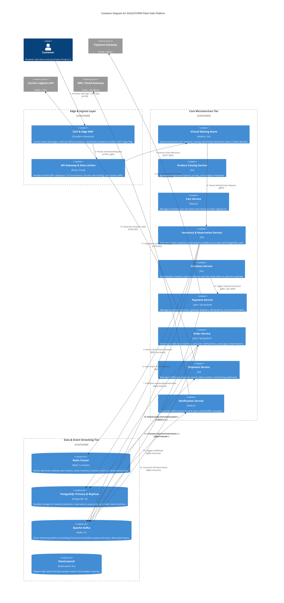

# C4 Level 2: Container Diagram

The Container diagram illustrates the high-level technical architecture of SALESTORM, depicting microservices, datastores, event buses, and communication boundaries.

---

## Service & Datastore Responsibilities

### 1. Ingress & Edge Layer
* **CDN & Edge WAF:** Intercepts traffic at the edge. Serves cached static assets and immediately blocks non-admitted buyers when stock reaches zero by checking a distributed KV flag (`SOLD_OUT`).
* **API Gateway (Kong):** Validates stateless JWT auth headers, strips illegal request parameters, enforces IP-based rate limiting, and routes legitimate requests downstream.

### 2. Core Microservices
* **Virtual Waiting Room:** Implements a token-bucket queueing system. Limits ingress flow into the Inventory Reservation Service to a safe rate ($100\text{ req/sec}$).
* **Inventory & Reservation Service:** High-performance Go microservice executing atomic stock allocation using Redis Lua scripts. Handles inventory state transitions (`AVAILABLE` $\rightarrow$ `RESERVED`).
* **Payment Service:** Java Spring Boot service wrapping external payment gateways. Implements strict idempotency using `reservation_id`, resilient circuit breakers, and exponential backoff retry algorithms.
* **Order Service:** Maintains the definitive order lifecycle state machine (`CREATED` $\rightarrow$ `PAYMENT_PENDING` $\rightarrow$ `CONFIRMED` $\rightarrow$ `SHIPPED`). Utilizes idempotent consumers (`processed_events` table) to guarantee exactly-once order generation even under broker retries or service restarts.

### 3. Data & Event Streaming Infrastructure
* **Redis Cluster:** Memory-tier gatekeeper. Evaluates stock decrement operations in $<2\text{ ms}$ via Lua scripts to eliminate database row contention.
* **PostgreSQL (Primary + Read Replicas):** Authoritative persistent ledger. Enforces relational integrity, transactional outboxes, and explicit `CHECK(available_quantity >= 0)` constraints.
* **Apache Kafka:** Asynchronous backbone. Decouples fast checkout/reservation pipelines from downstream fulfillment, order creation, and notification services.

---

## Architectural Trade-Offs

1. **Microservice Granularity vs Operational Complexity:**
   * *Trade-off:* Splitting Checkout, Inventory, Payment, and Order into discrete microservices requires network hops, gRPC serialization overhead, and distributed saga orchestrations.
   * *Justification:* Isolated scaling. High CPU usage in Payment processing or slow response times from Courier Logistics will never starve CPU resources of the core Inventory Reservation engine.
2. **Kafka Eventual Consistency for Orders:**
   * *Trade-off:* Buyers experience a transient 1-2 second delay between payment completion and order confirmation UI rendering.
   * *Justification:* Guaranteed durability. If the Order Service experiences a 30-second crash, Kafka holds `PaymentConfirmed` events safely without losing customer payments or aborting transactions.
