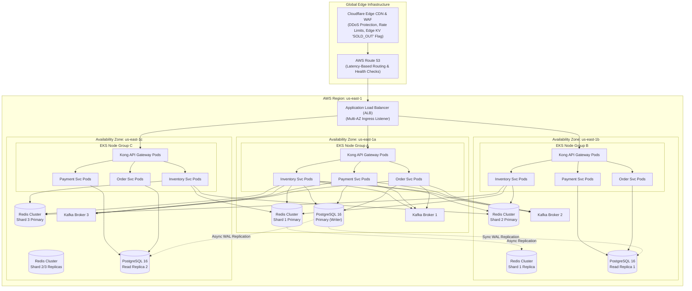

# Multi-AZ Deployment Architecture Diagram

This document describes the cloud deployment topology for SALESTORM hosted on AWS across three Availability Zones (`us-east-1a`, `us-east-1b`, `us-east-1c`).

---

## Infrastructure Topology Breakdown

### 1. Edge & Load Balancing Layer
* **Cloudflare Enterprise Edge:** Provides global Anycast routing, DDoS mitigation, and edge execution. Stores the distributed `SOLD_OUT` flag in Cloudflare Workers KV to short-circuit invalid buyer requests within $<10\text{ ms}$.
* **AWS Application Load Balancer (ALB):** Multi-AZ deployment distributing HTTP/2 and HTTPS ingress across Kong API Gateway pods in EKS Node Groups.

### 2. Kubernetes Compute Layer (AWS EKS)
* **Cluster Configuration:** Amazon EKS running Kubernetes 1.30 across 3 AZs.
* **Autoscaling Strategy:**
  * **Horizontal Pod Autoscaler (HPA):** Scales compute pods based on CPU utilization (>70%) and custom Prometheus metrics (`http_requests_in_flight`).
  * **Cluster Autoscaler (Karpenter):** Dynamically provisions EC2 Compute Instances (`c6i.4xlarge`) into EKS node groups within $<45\text{ seconds}$ of queue buildup.

### 3. Database & Memory Cache Tier
* **Amazon RDS PostgreSQL 16 (Multi-AZ):**
  * **Primary (AZ-a):** Handles all write transactions (`INSERT`, `UPDATE`, `DELETE`).
  * **Read Replicas (AZ-b & AZ-c):** Process read-only traffic (product catalog views, order status history lookups).
  * **Failover Mechanism:** AWS Multi-AZ synchronous physical block-level replication. Automatic failover completes within $<30\text{ seconds}$ with zero data loss ($RPO = 0$).
* **Amazon ElastiCache for Redis Cluster:**
  * **Cluster Topology:** 3 Shards, each containing 1 Primary node and 1 Replica node deployed across AZs.
  * **In-Memory Partitioning:** Data sharded using hash slots mapped by `product_id` key hashes.

### 4. Event Streaming Tier (AWS MSK)
* **Managed Streaming for Apache Kafka:** 3 Kafka brokers distributed symmetrically across AZ-a, AZ-b, and AZ-c.
* **Topic Replication Factor:** Minimum replication factor = 3; `min.insync.replicas = 2` to ensure durable message retention even during an availability zone outage.

---

## Failover & High Availability Specifications

| Subsystem Component | Primary Failure Mode | Automated Recovery Protocol | Recovery Time Objective (RTO) |
| :--- | :--- | :--- | :--- |
| **Availability Zone Outage** | Complete loss of `us-east-1a` | ALB reroutes traffic to `us-east-1b` and `us-east-1c`. AWS RDS triggers failover to replica. | RTO < 30 seconds |
| **Redis Master Node Crash** | Memory node hardware failure | Redis Sentinel / Cluster Manager promotes replica to master automatically. | RTO < 5 seconds |
| **Kafka Broker Crash** | Broker node disk error | Kafka partition leader re-elected among remaining in-sync brokers (ISR). | RTO < 2 seconds |
| **API Gateway Pod Crash** | OOM / Uncaught Exception | Kubernetes Kubelet restarts pod; ALB health check removes dead instance. | RTO < 3 seconds |

---

## Architectural Trade-Offs

1. **Multi-AZ Network Latency vs High Availability:**
   * *Trade-off:* Cross-AZ data replication between primary PostgreSQL/Redis and secondary replicas incurs a 1ms to 2ms cross-AZ network hop latency.
   * *Justification:* Necessary to guarantee high availability (99.99%) and regional disaster recovery.
2. **Synchronous DB Replication Cost:**
   * *Trade-off:* Synchronous WAL replication on the primary DB replica increases transaction commit latency by ~2ms.
   * *Justification:* Ensures RPO = 0 for critical financial payment records and inventory ledgers.
