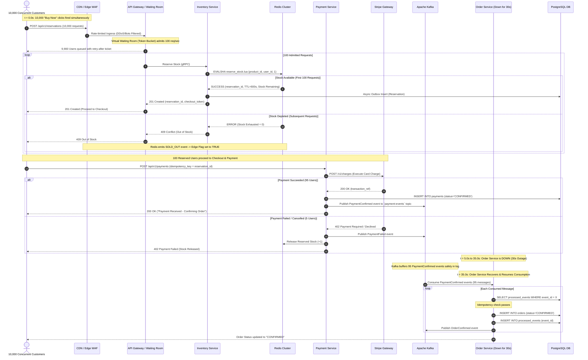

# High-Level Design Overview & Request Path Analysis

This document provides a comprehensive overview of communication semantics, system bottleneck scalability, and end-to-end trace analysis for 10,000 concurrent "Buy Now" requests.

---

## 1. Synchronous vs. Asynchronous Communication Matrix

| Communication Path | Protocol / Pattern | Type | Architecture Justification | Trade-off / Risk |
| :--- | :--- | :--- | :--- | :--- |
| **Client $\rightarrow$ API Gateway** | HTTPS / REST | **Sync** | Real-time user feedback required for authentication, waiting room placement, and reservation token responses. | Client network drop causes user retries. |
| **Gateway $\rightarrow$ Waiting Room** | HTTP / gRPC | **Sync** | Immediate evaluation of token bucket rate limits required before request ingress. | Waiting room latency directly adds to user round-trip time. |
| **Waiting Room $\rightarrow$ Inventory Svc**| gRPC | **Sync** | Critical path. Requires deterministic, low-latency reservation confirmation before checkout. | Must complete within <20ms to prevent thread pool starvation. |
| **Inventory Svc $\rightarrow$ Redis Cluster** | RESP (Lua Script) | **Sync** | Single-threaded atomic evaluation of stock counter and customer purchase limits. | Redis master crash requires fast failover to prevent transaction blocking. |
| **Inventory Svc $\rightarrow$ PostgreSQL** | Async Outbox Pattern | **Async** | Offloads durable disk writes from the real-time reservation path. | Transient state gap between Redis in-memory gate and DB disk WAL. |
| **Checkout Svc $\rightarrow$ Payment Svc** | gRPC / REST | **Sync** | Payment authorization must occur while reservation token remains valid (10m TTL). | External payment gateway latency (500-2000ms) blocks checkout thread. |
| **Payment Svc $\rightarrow$ Kafka Broker** | Kafka Outbox Producer | **Async** | Decouples payment capture from downstream order creation and fulfillment pipelines. | ~50ms outbox publishing latency before downstream processing begins. |
| **Kafka $\rightarrow$ Order Service** | Kafka Consumer | **Async** | Absorbs Order Service downtime (e.g., 30s outages) without dropping customer transactions. | User sees "Order Processing" status until consumer persists record. |
| **Order Svc $\rightarrow$ Courier Logistics** | Kafka Event Listener | **Async** | Shipping label generation is non-critical for immediate transaction settlement. | Logistics API failures require exponential backoff retries in worker pool. |

---

## 2. System Bottleneck Analysis & Scaling Strategy

```
Ingress (500k req/s) ──> [Edge CDN Gate] ──(98% Throttled)──> [Waiting Room] ──(100 req/s)──> [Redis Lua Gate] ──> [Postgres Outbox]
                                                                                                ▲
                                                                                                │
                                                                                   Primary Core Bottleneck
```

### Bottleneck 1: High-Concurrency Inventory Row Contention
* **Problem:** If 10,000 concurrent requests execute `UPDATE inventory SET quantity = quantity - 1 WHERE product_id = X` directly against PostgreSQL, row-level locks force sequential execution. Database connection pools exhaust in $<500\text{ ms}$, causing cascading HTTP 504 gateway timeouts.
* **Resolution Strategy:** Offload inventory lock evaluation entirely to Redis memory via an atomic Lua script (`EVALSHA`). Redis processes the stock decrement in $<1.5\text{ ms}$ in a single thread. PostgreSQL is updated asynchronously via worker queues.

### Bottleneck 2: External Payment Gateway Throughput Limits
* **Problem:** External payment providers (Stripe/Adyen) enforce strict API rate limits (e.g., 100-500 requests/sec per API key) and exhibit variable response latencies (500ms to 2000ms).
* **Resolution Strategy:**
  1. Virtual Waiting Room throttles payment initiation flow to match gateway quota limits.
  2. Implement Resilience4j Circuit Breakers and Bulkheads to restrict concurrent outbound payment connections, returning immediate graceful retries under gateway throttling.

### Bottleneck 3: Kafka Partition Consumer Bottleneck
* **Problem:** Single-partition Kafka topics force single-threaded event consumption, leading to message backlogs during flash sales.
* **Resolution Strategy:** Partition keying by `product_id` or `reservation_id` across 32 Kafka partitions. Allows 32 Order Service consumer instances to process payment events in parallel.

---

## 3. Request Path Trace: 10,000 Concurrent "Buy Now" Clicks

The following trace details the precise step-by-step lifecycle of $10,000$ users clicking "Buy Now" simultaneously for Product X ($Stock = 100$).



---

## 4. Key Execution Phase Milestones

1. **Phase 1: Ingress & Queueing ($t = 0.0s$):**
   * $10,000$ incoming HTTP requests hit Cloudflare Edge.
   * $9,900$ requests enter the Virtual Waiting Room, receiving an HTTP 202 status with a polling endpoint and `Retry-After: 2` header.
2. **Phase 2: Atomic Reservation Gate ($t = 0.1s - 1.0s$):**
   * 100 admitted requests hit the Inventory Service.
   * Redis Lua script executes sequentially for each user. Exactly $100$ reservations succeed; stock balance drops to zero ($0$).
   * Redis triggers an async webhook updating the Cloudflare Edge KV store flag `SOLD_OUT = true`.
3. **Phase 3: Edge Short-Circuiting ($t > 1.0s$):**
   * Remaining waiting-room users and fresh incoming buyers hit the CDN edge.
   * Cloudflare reads `SOLD_OUT = true` and immediately returns a static HTTP 200 "Sold Out" response, bypassing core backend services entirely.
4. **Phase 4: Payment Capture & Indeterminate Handling ($t = 1.0s - 3.0s$):**
   * $100$ reservation holders invoke `/api/v1/payments`.
   * $95$ payments succeed. $5$ payments fail due to card declines. The Payment Service issues an inventory release event for the $5$ failed reservations, making 5 units available for queue backfill.
5. **Phase 5: Resilient Order Creation during Service Outage ($t = 5.0s - 35.0s$):**
   * Order Service experiences a 30-second container outage.
   * The $95$ successful `PaymentConfirmed` events remain durably stored in Apache Kafka topic `payment-events`.
   * At $t = 35.0s$, Order Service pods recover, poll Kafka, check the `processed_events` idempotency table, and insert $95$ orders into PostgreSQL with zero message loss or duplicate creation.
