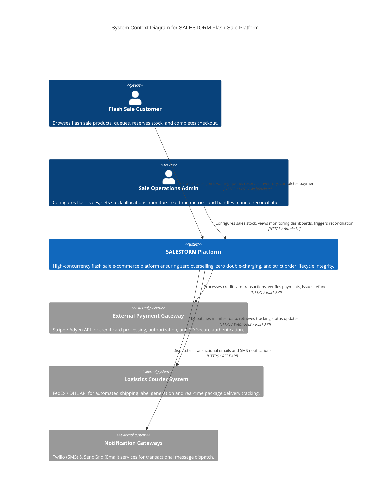

# C4 Level 1: System Context Diagram

The System Context diagram outlines the boundaries of the SALESTORM platform, its primary human users, and external integrations.

---

## Component Rationale & Architecture Justification

### 1. SALESTORM Platform Core
* **Why it exists:** Provides an isolated, resilient system designed specifically to survive 500,000 req/s flash sale ingress traffic spikes while preserving strict transactional guarantees for inventory, payments, and orders.
* **Key Responsibility:** Manages state transitions from browsing to order delivery, preventing resource starvation of core database engines.

### 2. External Payment Gateway (Stripe/Adyen)
* **Why it exists:** Offloads PCI-DSS compliance and financial settlement infrastructure.
* **Integration Pattern:** Synchronous tokenized charge requests with async fallback webhooks for handling network drops and pending state resolutions.

### 3. External Logistics Courier System (FedEx/DHL)
* **Why it exists:** Handles physical packaging label creation and route tracking.
* **Integration Pattern:** Fully asynchronous background event invocation driven by post-checkout fulfillment services.

### 4. External Notification Providers (Twilio/SendGrid)
* **Why it exists:** Isolates bulk outbound message delivery (email/SMS) from core transaction processing threads.

---

## Trade-Off Analysis

* **External Dependency Coupling:**
  * *Trade-off:* Relying on external payment gateways introduces non-deterministic latency (500ms to 2000ms) and potential external API outages.
  * *Mitigation:* SALESTORM isolates payment gateway calls behind circuit breakers, bounded timeout retries, and asynchronous transactional state handling (`PAYMENT_UNKNOWN`).
