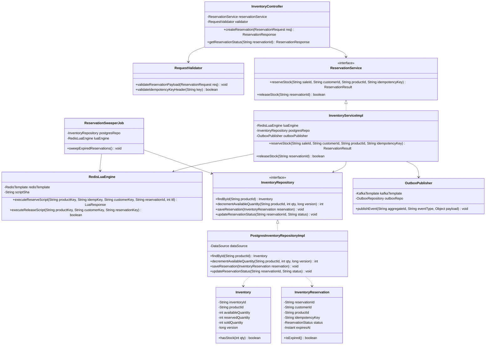

# Low-Level Class Diagram: Inventory & Reservation Service

This document specifies the internal Object-Oriented software design for the Inventory & Reservation microservice.

---

## Component Responsibilities & Exception Boundary Mapping

1. **`InventoryController` & `RequestValidator` (Validation Boundary):**
   * Validates structural REST/gRPC input parameters.
   * Throws `InvalidPayloadException` (HTTP 400) or `MissingIdempotencyKeyException` (HTTP 400).
2. **`RedisLuaEngine` (Idempotency & Fast Gate):**
   * Encapsulates Redis interaction. Catches `RedisConnectionException` and gracefully degrades by logging a critical error or querying PostgreSQL fallback.
   * Returns structured `LuaResponse` (`SUCCESS`, `OUT_OF_STOCK`, `ALREADY_PROCESSED`).
3. **`InventoryServiceImpl` & `PostgresInventoryRepositoryImpl` (Persistence Boundary):**
   * Manages DB persistence. Catches `OptimisticLockException` if version verification fails.
   * Ensures outbox events are written in the same local SQL transaction block.
4. **`ReservationSweeperJob` (Background Cleanup):**
   * Polling thread. Scans expired records in PostgreSQL (`expires_at < NOW()`) and executes idempotent inventory release via `RedisLuaEngine`.

---

## Architectural Trade-Offs

* **Interface Abstraction Overhead:**
  * *Trade-off:* Creating `ReservationService` and `InventoryRepository` interfaces adds boiler-plate interface files.
  * *Justification:* Satisfies Dependency Inversion Principle (DIP). Allows mocking datastores during unit testing and swapping PostgreSQL/Redis driver implementations without refactoring controller logic.
