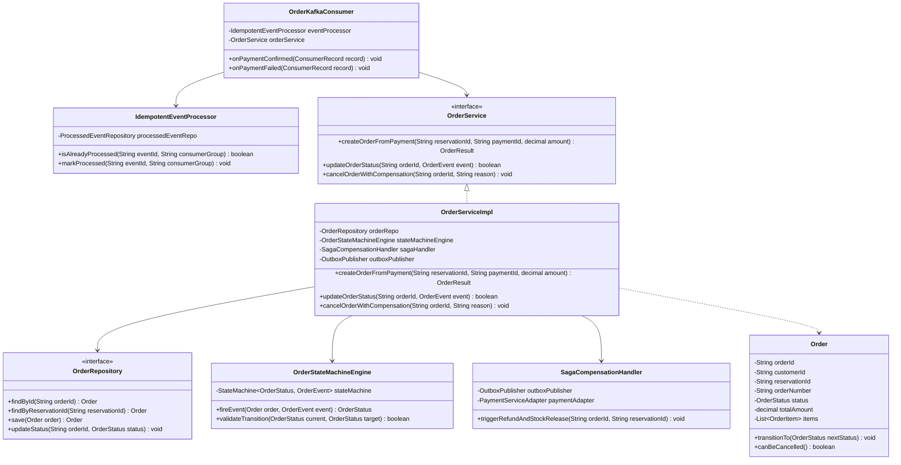

# Low-Level Class Diagram: Order Service

This document describes the Object-Oriented structure of the Order microservice, detailing state machine management, consumer idempotency, and compensation saga orchestration.

---

## Component Responsibilities & State Handling

1. **`IdempotentEventProcessor` (Consumer Guard):**
   * Inspects `processed_event` database table before executing business logic. Catches `DuplicateEventException` and commits Kafka offsets safely without processing duplicates.
2. **`OrderStateMachineEngine` (State Control):**
   * Enforces legal order state transitions (`CREATED` $\rightarrow$ `CONFIRMED` $\rightarrow$ `PROCESSING` $\rightarrow$ `SHIPPED` $\rightarrow$ `DELIVERED`). Throws `IllegalStateTransitionException` if invalid transitions are attempted (e.g., `SHIPPED` $\rightarrow$ `CREATED`).
3. **`SagaCompensationHandler` (Rollback Engine):**
   * Executes saga compensation workflows if downstream order fulfillment fails. Publishes `RefundInitiated` and `StockReleaseRequested` events to Kafka.

---

## Architectural Trade-Offs

* **Strict State Machine Validation:**
  * *Trade-off:* State machine transition rules reject out-of-order Kafka events (e.g., `ShipmentDispatched` arriving before `OrderConfirmed`).
  * *Justification:* Prevents corrupting order lifecycle data. Out-of-order events are routed to a Kafka retry buffer topic to await parent state completion.
