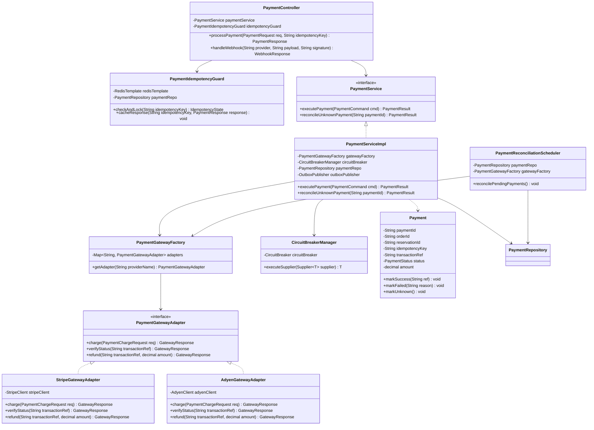

# Low-Level Class Diagram: Payment Service

This document details the internal class structure for the Payment microservice, highlighting payment gateway abstraction, circuit breaker fault-tolerance, and idempotency enforcement.

---

## Component Responsibilities & Exception Handling

1. **`PaymentIdempotencyGuard` (Idempotency Filter):**
   * Checks Redis for active `idempotency_key`.
   * Throws `DuplicatePaymentException` or returns cached `PaymentResponse` if already processed.
2. **`CircuitBreakerManager` (Fault Isolation):**
   * Wraps external network calls to Stripe/Adyen.
   * Intercepts `TimeoutException` or `ConnectException`. If error rate > 50%, trips circuit to `OPEN`, throwing `CallNotPermittedException` (HTTP 503 Service Unavailable).
3. **`PaymentGatewayFactory` & Adapters (Strategy Pattern):**
   * Decouples payment execution logic from provider-specific REST APIs. Allows seamless fallback from Stripe to Adyen.
4. **`PaymentReconciliationScheduler` (Indeterminate State Resolution):**
   * Polling engine inspecting payments stuck in `PAYMENT_UNKNOWN` state. Queries external gateway APIs to resolve status safely without duplicate charges.

---

## Architectural Trade-Offs

* **Circuit Breaker Retry Delays:**
  * *Trade-off:* When the circuit breaker trips `OPEN`, valid customer payments are immediately rejected with HTTP 503 for a 10-second sleep window.
  * *Justification:* Prevents thread pool exhaustion and keeps the payment microservice responsive for other system operations during external provider degradation.
