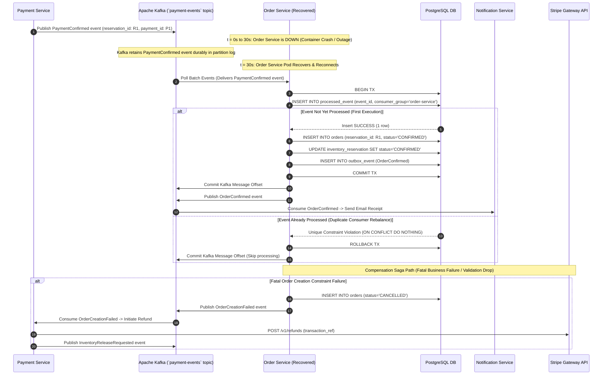

# Sequence Diagram: Resilient Order Creation & Outage Recovery

This document details event-driven order creation, consumer idempotency during a 30-second Order Service container outage, and compensation saga refund workflows.

---

## Key Resilience Mechanisms

1. **Kafka Buffer Durability:** During the 30-second Order Service downtime, Kafka retains unconsumed `PaymentConfirmed` events safely without losing messages or failing upstream payments.
2. **Consumer Idempotency:** The `processed_event` database table guarantees that consumer restarts or partition rebalances never produce duplicate order rows.
3. **Automated Compensation Saga:** If order creation encounters unrecoverable errors, a compensation event triggers a full financial refund via Stripe and stock restoration in Redis.

---

## Architectural Trade-Offs

* **Transactional Outbox Scraper Delay:**
  * *Trade-off:* Outbox polling thread introduces a ~50ms delay between DB transaction commit and Kafka message availability.
  * *Justification:* Guarantees dual-write consistency. DB changes and Kafka events never become out-of-sync.
