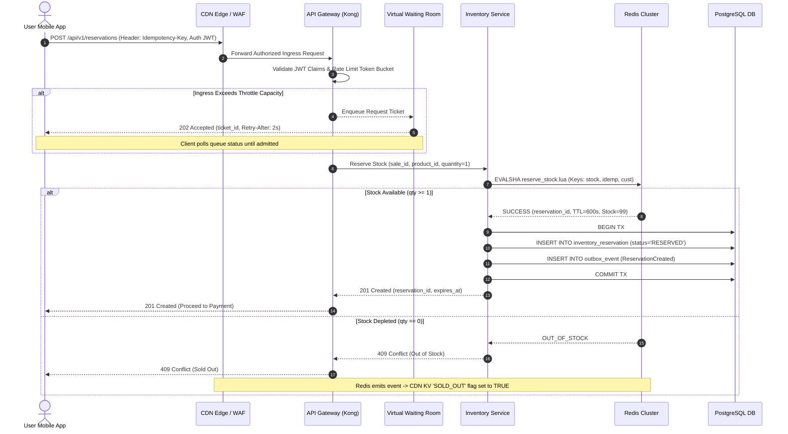

# Sequence Diagram: Purchase & Inventory Reservation

This document illustrates the detailed message sequence for user authentication, admission control, and atomic inventory reservation.

---

## Key Execution Phases

1. **Edge Interception & Token Bucket Rate Limiting:** API Gateway strips invalid JWTs and enforces user IP rate limits.
2. **Atomic Lua Gate:** Redis evaluates stock decrement in single-threaded memory thread ($<1.5\text{ ms}$).
3. **Outbox Pattern:** Local ACID SQL transaction writes reservation record and outbox event simultaneously.

---

## Architectural Trade-Offs

* **Waiting Room Polling Overhead:**
  * *Trade-off:* 202 Accepted polling forces clients to send repeated status HTTP requests every 2 seconds.
  * *Justification:* Shields backend microservices from unpredictable traffic spikes.
