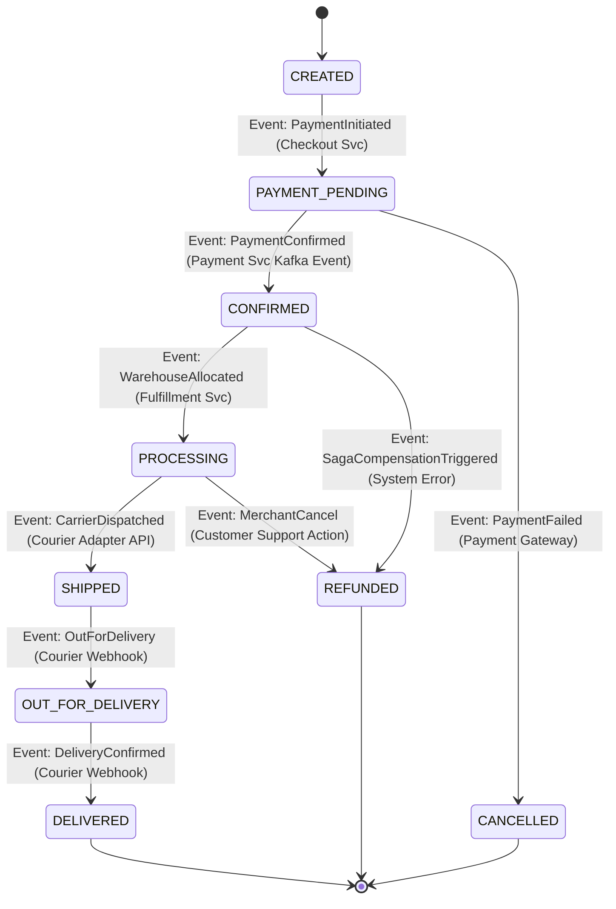

# Order Lifecycle State Machine

This document specifies the formal state machine governing order processing, fulfillment, delivery tracking, and cancellations in SALESTORM.

---

## State Transition Matrix

| Current State | Target State | Triggering Event | Actor / Source | Business Validation Rules |
| :--- | :--- | :--- | :--- | :--- |
| `CREATED` | `PAYMENT_PENDING` | `PaymentInitiated` | Checkout Service | Valid reservation token bound to cart. |
| `PAYMENT_PENDING`| `CONFIRMED` | `PaymentConfirmed` | Payment Svc Event | Stripe/Adyen transaction verified. |
| `CONFIRMED` | `PROCESSING` | `WarehouseAllocated` | Fulfillment Svc | Warehouse inventory allocated for pick & pack. |
| `PROCESSING` | `SHIPPED` | `CarrierDispatched` | Courier Logistics API | Tracking label generated by FedEx/DHL. |
| `SHIPPED` | `OUT_FOR_DELIVERY`| `OutForDelivery` | Courier Webhook | Courier driver scanned parcel on delivery route. |
| `OUT_FOR_DELIVERY`| `DELIVERED` | `DeliveryConfirmed` | Courier Webhook | Customer signature captured upon delivery. |
| `CONFIRMED` | `REFUNDED` | `SagaCompensation` | Order Service Saga | System failure during fulfillment phase. |

---

## Forbidden / Illegal State Transitions

The `OrderStateMachineEngine` enforces immutability by throwing `IllegalOrderStateTransitionException` for:

1. ❌ **`DELIVERED` $\rightarrow$ `PROCESSING`** (Terminal delivery states cannot be re-opened for warehouse processing).
2. ❌ **`CANCELLED` $\rightarrow$ `CONFIRMED`** (Cancelled orders cannot be resurrected).
3. ❌ **`SHIPPED` $\rightarrow$ `CREATED`** (Dispatched parcels cannot revert to draft status).

---

## Architectural Trade-Offs

* **Terminal State Immutability:**
  * *Trade-off:* Once an order enters `DELIVERED` or `REFUNDED`, database rules prevent state updates, requiring separate domain entities for returns/exchanges.
  * *Justification:* Ensures audit trail compliance and financial ledger consistency.
