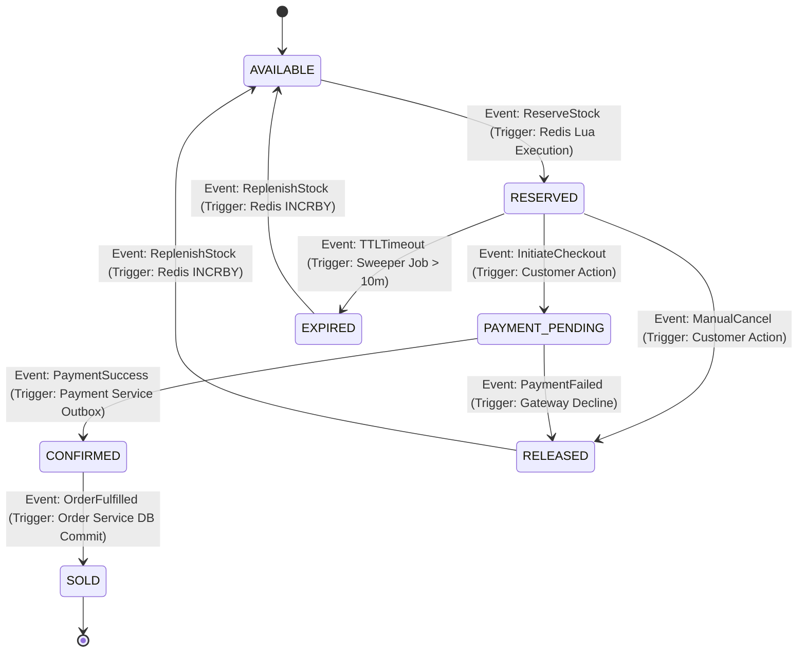

# Inventory Reservation Lifecycle State Machine

This document defines the formal state machine for inventory reservations in SALESTORM, detailing valid state transitions, trigger conditions, and forbidden/illegal state transitions.

---

## State Transition Matrix

| Current State | Target State | Triggering Event | Actor / Source | Business Validation Rules |
| :--- | :--- | :--- | :--- | :--- |
| `AVAILABLE` | `RESERVED` | `ReserveStock` | Redis Lua Engine | Stock counter $> 0$, user limit not exceeded. |
| `RESERVED` | `PAYMENT_PENDING` | `InitiateCheckout` | Customer / Checkout Svc | Reservation TTL $< 10\text{ minutes}$. |
| `PAYMENT_PENDING`| `CONFIRMED` | `PaymentSuccess` | Payment Svc Outbox | Gateway transaction verified successful. |
| `CONFIRMED` | `SOLD` | `OrderFulfilled` | Order Svc | Order persisted, stock permanently deducted in DB. |
| `RESERVED` | `EXPIRED` | `TTLTimeout` | Sweeper Cron Daemon | `expires_at < NOW()`. |
| `PAYMENT_PENDING`| `RELEASED` | `PaymentFailed` | Payment Gateway Adapter | Card charge declined. |

---

## Forbidden / Illegal State Transitions

The state machine engine explicitly rejects the following invalid transitions by throwing an `IllegalReservationStateTransitionException`:

1. ❌ **`SOLD` $\rightarrow$ `AVAILABLE`** (Prevented to prevent double-selling fulfilled items).
2. ❌ **`EXPIRED` $\rightarrow$ `CONFIRMED`** (Prevented to block payments on expired reservation tokens).
3. ❌ **`RELEASED` $\rightarrow$ `PAYMENT_PENDING`** (Prevented to block checkout initiation on returned stock).

---

## Architectural Trade-Offs

* **Strict State Enforcement Overhead:**
  * *Trade-off:* Validating reservation state transitions requires explicit database lock or version checks before updating state.
  * *Justification:* Prevents race conditions where a customer completes payment on a reservation that was expired by the background sweeper 1 second prior.
