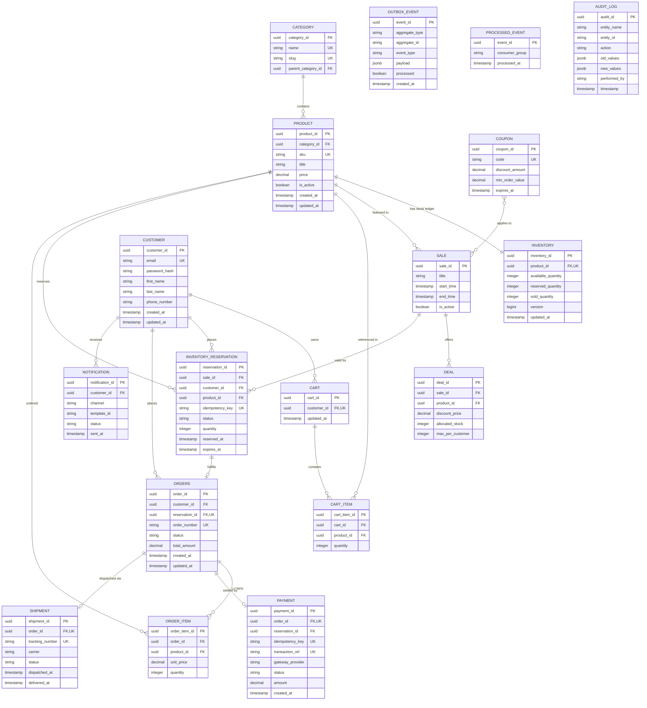

# Entity-Relationship Diagram (ERD)

This document specifies the relational data model for the SALESTORM platform, illustrating core domain entities, transaction ledgers, event outboxes, and audit logs.

---

## Entity Relationship Descriptions

1. **Product & Inventory Ledger:**
   * `PRODUCT` to `INVENTORY` is a 1-to-1 strict relationship. The `INVENTORY` table maintains real-time physical balances (`available_quantity`, `reserved_quantity`, `sold_quantity`).
2. **Flash Sale & Deals:**
   * `SALE` contains multiple `DEAL` entries, defining allocated stock caps and per-customer limits during high-concurrency windows.
3. **Inventory Reservation & Orders:**
   * `INVENTORY_RESERVATION` tracks temporal holds ($10\text{ min}$ TTL). An `ORDERS` record maintains a 1-to-1 reference to a single reservation.
4. **Outbox & Idempotency Infrastructure:**
   * `OUTBOX_EVENT`, `PROCESSED_EVENT`, and `AUDIT_LOG` exist as decoupled transactional infrastructure entities to support reliable event delivery and auditing without foreign key constraints to domain models.

---

## Trade-Off Analysis

* **Decoupled Outbox and Audit Tables:**
  * *Trade-off:* `OUTBOX_EVENT` and `PROCESSED_EVENT` lack foreign keys to `ORDERS` or `INVENTORY_RESERVATION`.
  * *Justification:* Prevents schema lock contention during high-speed batch event writes and allows outbox rows to be purged independently without cascading locks.
