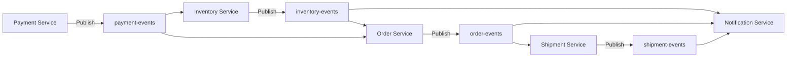

# Event-Driven Architecture & Kafka Messaging Specification

This document details event semantics, topic ownership, consumer idempotency, and error handling policies for Apache Kafka in the SALESTORM platform.

---

## 1. Commands vs. Events Paradigm

* **Commands (Synchronous Intent):** Point-to-point requests directing a target service to perform an action (e.g., `ReserveStockCommand` dispatched via gRPC from API Gateway to Inventory Service). Commands can be rejected if business rules are violated.
* **Events (Asynchronous Fact):** Immutable notifications published to Kafka topics asserting a state change that has already occurred (e.g., `PaymentConfirmed`). Events cannot be rejected; consuming microservices must process or buffer them.

---

## 2. Kafka Topic Ownership & Event Taxonomy



| Kafka Topic | Event Name | Producer Service | Key Schema | Consuming Services & Responsibilities |
| :--- | :--- | :--- | :--- | :--- |
| `inventory-events` | `ReservationCreated` | Inventory Svc | `product_id` | **Order Svc:** Pre-populates pending order draft.<br/>**Notif Svc:** Dispatches "Stock Reserved" push alert. |
| `inventory-events` | `ReservationExpired` | Inventory Svc | `product_id` | **Payment Svc:** Cancels active payment tokens.<br/>**Notif Svc:** Dispatches "Reservation Expired" SMS. |
| `payment-events` | `PaymentConfirmed` | Payment Svc | `reservation_id` | **Order Svc:** Idempotently generates order & updates state to `CONFIRMED`.<br/>**Inventory Svc:** Marks reservation as `SOLD`. |
| `payment-events` | `PaymentFailed` | Payment Svc | `reservation_id` | **Inventory Svc:** Releases stock back to available pool (`INCRBY`). |
| `order-events` | `OrderConfirmed` | Order Svc | `order_id` | **Shipment Svc:** Triggers courier fulfillment dispatch.<br/>**Notif Svc:** Sends email order confirmation receipt. |
| `shipment-events` | `ShipmentDispatched`| Shipment Svc | `order_id` | **Notif Svc:** Sends tracking link via SMS. |

---

## 3. Idempotent Consumer Pattern (`processed_events` Table)

To guarantee **exactly-once processing semantics** under Kafka message retries or consumer group rebalances, every consumer executes the following pattern within a database transaction:

```sql
BEGIN;

-- 1. Check & Insert Event Unique ID into processed_event table
INSERT INTO processed_event (event_id, consumer_group, processed_at)
VALUES ($1, 'order-service-group', CURRENT_TIMESTAMP)
ON CONFLICT (event_id, consumer_group) DO NOTHING;

-- 2. If row was not inserted, event was already processed -> ABORT
-- If row inserted, proceed with business logic
INSERT INTO orders (order_id, customer_id, reservation_id, status, total_amount)
VALUES ($2, $3, $4, 'CONFIRMED', $5);

COMMIT;
```

---

## 4. Dead-Letter Queue (DLQ) & Retry Policy

```
[Main Topic: payment-events]
       │
       ├──(Processing Succeeded)──> [Commit Kafka Offset]
       │
       └──(Transient Exception e.g., DB Timeout)
               │
               ▼
   [Retry Topic: payment-events-retry-1] (5s Delay)
               │
               ├──(Success)──> [Commit Offset]
               │
               └──(Fatal Exception after 3 Retries)
                       │
                       ▼
           [Dead Letter Queue: payment-events-dlq] ──> [Alert PagerDuty & Ops Dashboard]
```

### Execution Rules:
1. **Transient Failures (Network Timeout, DB Lock Wait):**
   * Message routed to retry topics (`{topic}-retry-1`, `{topic}-retry-2`) with exponential backoff delays ($5\text{s}$, $25\text{s}$, $125\text{s}$).
2. **Fatal Failures (JSON Malformation, Constraint Violation):**
   * Immediately published to `{topic}-dlq` topic without further retries.
3. **DLQ Alerting & Reconciliation:**
   * Operations Dashboard alerts engineers. An automated replay tool allows ops to re-inject fixed messages into the primary topic.

---

## 5. Architectural Trade-Offs

* **Consumer Storage Overhead for Idempotency:**
  * *Trade-off:* Writing to `processed_event` adds a DB insert per consumed Kafka event.
  * *Justification:* Prevents duplicate order creation or double notifications when Kafka rebalances partitions during node failures.
