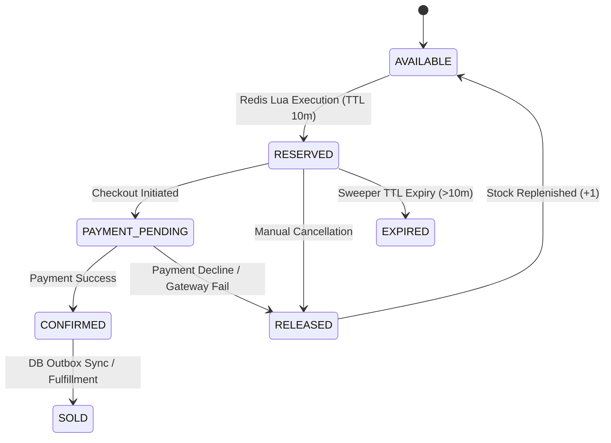

# High-Concurrency Inventory Control & Lock Analysis

This document presents the detailed architectural design of SALESTORM's inventory contention gate, comparing concurrency strategies, providing exact Lua and SQL implementations, proving non-oversale guarantees, and walking through edge-case race conditions.

---

## 1. Concurrency Locking Strategy Comparison

| Metric / Dimension | Optimistic Locking (`version`) | Pessimistic Locking (`SELECT FOR UPDATE`) | Redis Atomic Ops (Lua Script) | **SALESTORM Hybrid (Chosen)** |
| :--- | :--- | :--- | :--- | :--- |
| **Max Throughput** | ~500 req/sec | ~150 req/sec | **> 100,000 req/sec** | **> 100,000 req/sec Gate** |
| **Contention Behavior** | High failure/retry rate under contention | Heavy row lock blocking, connection pool exhaustion | Single-threaded queue execution, zero lock contention | Fast gate filtering; async non-contended DB updates |
| **Failure Mode** | Aborts transactions; client must retry repeatedly | Database connection timeout (HTTP 504) | Memory node failure | Redis recovers from DB; DB enforces `CHECK(qty>=0)` |
| **Implementation Complexity**| Moderate | Low | Moderate | Moderate/High |

### Architectural Justification of the Hybrid Model
* **Why Pure Pessimistic Fails:** $10,000$ concurrent requests attempting `SELECT FOR UPDATE` on a single inventory row force $9,999$ threads to block waiting for database locks. Postgres connection pools crash within milliseconds.
* **Why Pure Optimistic Fails:** Under extreme contention, $99\%$ of transactions fail version verification (`version = old_version`), causing massive retry storms that overwhelm application servers.
* **Why Hybrid Fits Flash Sales:** Redis acts as a high-speed **gatekeeper** ($<2\text{ ms}$ processing time), eliminating lock contention completely. PostgreSQL serves as the authoritative, durable source of truth with strict relational schema `CHECK` constraints.

---

## 2. Code Implementations: Lua Script & PostgreSQL Update

### 2.1 Redis Atomic Reservation Script (`reserve_stock.lua`)

```lua
-- KEYS[1]: Stock Key (e.g. "inv:stock:prod_123")
-- KEYS[2]: Idempotency Key (e.g. "inv:idemp:req_abc")
-- KEYS[3]: Customer Limit Key (e.g. "inv:cust:prod_123:cust_999")
-- ARGV[1]: Requested Quantity (e.g. 1)
-- ARGV[2]: Reservation Expiry TTL in seconds (e.g. 600)
-- ARGV[3]: Reservation ID (UUID)

-- 1. Idempotency Check: Return existing reservation if request repeated
if redis.call("EXISTS", KEYS[2]) == 1 then
    return { "ALREADY_PROCESSED", redis.call("GET", KEYS[2]) }
end

-- 2. Customer Limit Check: Prevent duplicate purchases per customer
if redis.call("EXISTS", KEYS[3]) == 1 then
    return { "CUSTOMER_LIMIT_EXCEEDED", 0 }
end

-- 3. Stock Check & Decrement
local current_stock = tonumber(redis.call("GET", KEYS[1]) or "0")
local req_qty = tonumber(ARGV[1])

if current_stock >= req_qty then
    -- Atomically decrement stock
    redis.call("DECRBY", KEYS[1], req_qty)
    
    -- Record Idempotency Key mapped to Reservation ID
    redis.call("SET", KEYS[2], ARGV[3], "EX", ARGV[2])
    
    -- Set Customer Limit Flag
    redis.call("SET", KEYS[3], "1", "EX", ARGV[2])
    
    return { "SUCCESS", ARGV[3], tostring(current_stock - req_qty) }
else
    return { "OUT_OF_STOCK", 0 }
end
```

### 2.2 PostgreSQL Durable Conditional Update Query

```sql
-- Executed asynchronously by worker queue or reservation persistence layer
UPDATE inventory
SET 
    available_quantity = available_quantity - $1,
    reserved_quantity = reserved_quantity + $1,
    version = version + 1,
    updated_at = CURRENT_TIMESTAMP
WHERE 
    product_id = $2 
    AND available_quantity >= $1;
```

---

## 3. Walkthrough: Simultaneous Request Race Condition (Stock = 1)

Consider two concurrent requests ($Req_A$ from $User_A$, $Req_B$ from $User_B$) hitting the Redis master at the exact same millisecond when `available_stock = 1`.

```
Timeline (t)   Redis Single-Threaded Event Loop Engine
─────────────  ─────────────────────────────────────────────────────────────
t = 0.000ms    [Req_A and Req_B arrive at Redis Network Socket]
t = 0.001ms    Redis Event Loop dequeues Req_A for evaluation
t = 0.002ms    Lua Exec: GET "inv:stock:prod_X" -> returns 1
t = 0.003ms    Lua Exec: 1 >= 1 -> TRUE. DECRBY stock by 1 (Stock is now 0)
t = 0.004ms    Lua Exec: Writes Idempotency & Customer Keys for User_A
t = 0.005ms    Lua Exec completes -> Returns SUCCESS (reservation_id_A)
               -------------------------------------------------------------
t = 0.006ms    Redis Event Loop dequeues Req_B for evaluation
t = 0.007ms    Lua Exec: GET "inv:stock:prod_X" -> returns 0
t = 0.008ms    Lua Exec: 0 >= 1 -> FALSE.
t = 0.009ms    Lua Exec completes -> Returns OUT_OF_STOCK
```

* **Outcome:** Redis single-threaded engine guarantees absolute serial ordering. $User_A$ successfully reserves stock; $User_B$ receives `OUT_OF_STOCK` instantly. Overselling is mathematically impossible.

---

## 4. Reservation Lifecycle & Reconciliation Architecture



### 4.1 Idempotent Stock Release Algorithm
When a payment fails or a reservation expires, stock is returned to the pool using an idempotent Lua script:

```lua
-- KEYS[1]: Stock Key, KEYS[2]: Customer Limit Key, KEYS[3]: Reservation Key
if redis.call("EXISTS", KEYS[3]) == 1 then
    redis.call("INCRBY", KEYS[1], 1)
    redis.call("DEL", KEYS[2])
    redis.call("DEL", KEYS[3])
    return "RELEASED"
else
    return "ALREADY_RELEASED"
end
```

### 4.2 Redis-vs-PostgreSQL Reconciliation Sweeper Job
* **Purpose:** Ensures in-memory Redis counters match durable PostgreSQL inventory ledgers.
* **Cron Execution (Every 30 Seconds):**
  1. Queries PostgreSQL for active reservations: `SELECT count(*) FROM inventory_reservation WHERE status = 'RESERVED' AND expires_at > NOW()`.
  2. Queries PostgreSQL DB available stock balance: $DB_{avail}$.
  3. Inspects Redis key `inv:stock:prod_X`.
  4. If $|Redis_{stock} - (DB_{avail} - Active_{res})| > 0$, the sweeper flags an alert and recalculates Redis stock from DB state:
     $$Redis_{stock} = DB_{avail} - Active_{res}$$

### 4.3 Redis Crash & Recovery Protocol
If the primary Redis node crashes and loses un-persisted memory state:
1. Redis restarts / replica promoted.
2. System triggers **Cache Hydration Protocol**:
   * Reads `available_quantity` from PostgreSQL database: $DB_{avail}$.
   * Subtracts unexpired active reservations from `inventory_reservation` table: $Active_{res}$.
   * Sets Redis key atomically:
     `SET inv:stock:prod_X (DB_avail - Active_res)`

---

## 5. Mathematical Proof of Non-Oversale Guarantee

**Theorem:** Under any arbitrary concurrency load $M$ ($M > N$), the number of successful reservations $S$ generated by SALESTORM will never exceed initial available stock $N$.

$$S \le N$$

**Proof:**
1. Let initial stock counter in Redis be $S_0 = N$.
2. Every successful reservation request $r_i$ executes Lua script operation $S_{k} = S_{k-1} - 1$.
3. The Lua execution condition requires $S_{k-1} \ge 1$ for state transition to succeed.
4. Since Redis executes Lua scripts serially without interleaved writes:
   $$S_k = N - \sum_{i=1}^{k} 1 = N - k$$
5. Decrementing stops immediately when $S_k = 0$, rejecting all subsequent requests $k > N$.
6. PostgreSQL enforces a second safety net constraint: `CHECK (available_quantity >= 0)`.
7. Thus, $S \le N$ is strictly guaranteed under all condition sets. $\blacksquare$

---

## 6. End-to-End Test Trace: 10,000 Users / Stock = 100

```
+-----------------------------------------------------------------------------------+
| 10,000 Ingress Requests @ t = 0.0s (Stock N = 100)                                |
+-----------------------------------------------------------------------------------+
                                          │
                                          ▼
+-----------------------------------------------------------------------------------+
| Virtual Waiting Room (Throttles to 100 req/s rate)                                |
+-----------------------------------------------------------------------------------+
                                          │
                  ┌───────────────────────┴───────────────────────┐
                  ▼                                               ▼
+-----------------------------------+           +-----------------------------------+
| First 100 Requests (Admitted)     |           | 9,900 Remaining Requests          |
+-----------------------------------+           +-----------------------------------+
                  │                                               │
                  ▼                                               ▼
+-----------------------------------+           +-----------------------------------+
| Redis Lua Execution: SUCCESS      |           | Redis Lua Execution: OUT_OF_STOCK |
| - Stock decremented 100 -> 0      |           | - Stock = 0                       |
| - 100 Reservation IDs issued      |           | - Returns HTTP 409 Out of Stock   |
+-----------------------------------+           +-----------------------------------+
                  │                                               │
                  ▼                                               ▼
+-----------------------------------+           +-----------------------------------+
| 2% Duplicate Retries (2 Requests) |           | Edge SOLD_OUT Flag Set to TRUE    |
| - Idempotency Key match in Redis  |           | - Cloudflare drops all subsequent |
| - Returns original 201 Created    |           |   requests with HTTP 200 Sold Out |
+-----------------------------------+           +-----------------------------------+
```

---

## 7. Architectural Trade-Offs

* **Redis In-Memory State Dependency:**
  * *Trade-off:* Relying on Redis memory keys introduces transient state exposure if Redis fails before writing outbox events to PostgreSQL.
  * *Justification:* Necessary to achieve >100,000 req/sec performance. Mitigated by automated DB hydration recovery scripts and PostgreSQL `CHECK` constraints.
