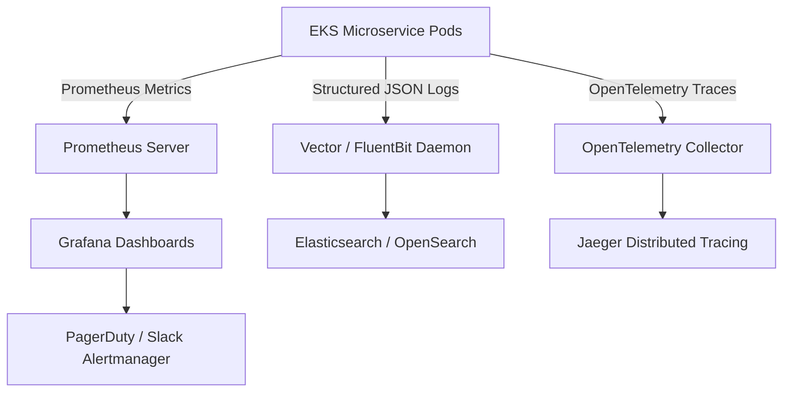

# Observability, Monitoring & Distributed Tracing

This document defines the 4-pillar observability architecture (Metrics, Logs, Traces, Alerts) for real-time flash-sale monitoring in SALESTORM.

---

## 1. Observability Architecture (The 4 Pillars)



### Pillar 1: Metrics (Prometheus & Grafana)
Tracks the **4 Golden Signals** (Latency, Traffic, Errors, Saturation):

* `salestorm_inventory_stock_available{product_id="X"}`: Real-time available stock balance in Redis.
* `salestorm_reservation_requests_total{status="success|out_of_stock"}`: Counter tracking reservation ingress rates.
* `salestorm_payment_duration_seconds_bucket`: Histogram measuring payment gateway latency SLA.
* `salestorm_order_outbox_lag_seconds`: Gauges lag in transactional outbox publication to Kafka.

### Pillar 2: Distributed Tracing (OpenTelemetry & Jaeger)
* Every request is injected with a `traceparent` W3C header at the API Gateway (`trace_id: 4bf92f3577b34da6a3ce929d0e0e4736`).
* Propagated synchronously across gRPC/REST calls and asynchronously inside Kafka message headers.
* Allows developers to visualize full trace spans across Gateway $\rightarrow$ Inventory $\rightarrow$ Redis $\rightarrow$ Payment $\rightarrow$ Kafka $\rightarrow$ Order Service.

### Pillar 3: Log Aggregation (ELK Stack)
* Structured JSON logging emitted to `stdout`:
  ```json
  {
    "timestamp": "2026-10-05T09:48:00.123Z",
    "level": "INFO",
    "service": "payment-service",
    "trace_id": "4bf92f3577b34da6a3ce929d0e0e4736",
    "idempotency_key": "pay_seq_101",
    "event": "PAYMENT_SETTLED",
    "amount": 299.99,
    "status": "SUCCESS"
  }
  ```

### Pillar 4: Alerting Thresholds (Alertmanager & PagerDuty)

| Alert Name | Severity | Condition | Action Protocol |
| :--- | :--- | :--- | :--- |
| `InventoryDivergenceAlert` | **CRITICAL** | $|Redis_{stock} - DB_{avail}| > 0$ for $>30\text{s}$ | Trigger automatic Redis cache re-hydration script. |
| `PaymentCircuitOpenAlert` | **HIGH** | Circuit Breaker state == `OPEN` for $>10\text{s}$ | Failover traffic to secondary gateway (Adyen). |
| `OrderOutboxLagHigh` | **WARNING** | Kafka outbox consumer lag $> 5000$ messages | Scale Order Service Kubernetes pods via HPA. |

---

## 2. Architectural Trade-Offs

* **Telemetry Performance Overhead:**
  * *Trade-off:* Exporting 100% of trace spans under 500,000 req/sec ingress consumes significant network and CPU bandwidth.
  * *Justification:* Mitigated by setting probabilistic tracing sampling to $1\%$ for standard requests and $100\%$ for failed or $>1000\text{ms}$ requests.
