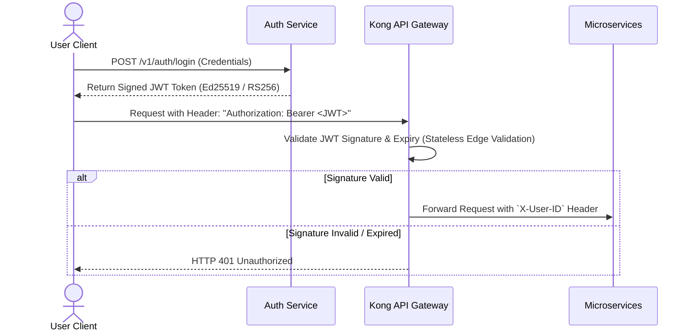

# Security Architecture & Threat Mitigation Matrix

This document outlines the end-to-end security model, threat vector mitigations, authentication flows, and PCI-DSS compliance boundaries for SALESTORM.

---

## 1. Security Architecture & Threat Mitigation Matrix

| Threat Vector | Attack Scenario | Defensive Control Mechanism | Architectural Enforcement Layer |
| :--- | :--- | :--- | :--- |
| **DDoS / Flash Crowds** | Botnets flooding 500,000 req/s to crash core services. | Anycast DDoS mitigation, HTTP request rate limiting, Cloudflare WAF rules. | Cloudflare Edge & Kong API Gateway |
| **Inventory Scraping / Hoarding** | Malicious users creating multiple accounts to buy out stock. | Device fingerprinting, CAPTCHA on queue entry, unique `(sale_id, customer_id)` constraint. | Virtual Waiting Room & Redis Lua Gate |
| **Man-in-the-Middle (MitM)** | Intercepting checkout sessions or JWT tokens. | TLS 1.3 encryption in transit, strict HSTS headers, SSL Pinning on mobile client. | Ingress Load Balancer (ALB) |
| **Double-Charging Cards** | Client retrying payment requests during network lag. | Mandatory `Idempotency-Key` header bound to `reservation_id` in Redis. | Payment Service Idempotency Guard |
| **SQL Injection & XSS** | Injecting malicious scripts in product search or checkout form. | Prepared statements (GORM / Hibernate ORM), strict OpenAPI parameter validation. | Microservice Controllers & PostgreSQL |
| **Data Leakage at Rest** | Stolen database snapshots containing customer PII. | AES-256 transparent database encryption, KMS key rotation. | AWS RDS Aurora Storage Engine |

---

## 2. Authentication & Authorization Flow

---

## 3. Data Protection & Compliance (PCI-DSS Boundary)

* **PCI-DSS Compliance Isolation:** SALESTORM servers **never** ingest, transmit, or store raw Primary Account Numbers (PAN) or CVVs. Direct card input is handled via Stripe/Adyen SDK elements, returning a tokenized string (`tok_1N8XXXXX`).
* **Secrets Management:** Database passwords, Stripe private API keys, and JWT private signing keys are fetched dynamically at runtime from **AWS Secrets Manager** with hourly IAM role rotation.

---

## 4. Architectural Trade-Offs

* **Stateless JWT Revocation Lag:**
  * *Trade-off:* Stateless JWTs cannot be revoked immediately without querying a centralized Redis blacklist on every request.
  * *Justification:* Keeping JWT validation stateless at the API Gateway permits processing >100k req/sec without causing Redis lookup bottlenecks. Short JWT expiration windows (15 minutes) mitigate window exposure.
